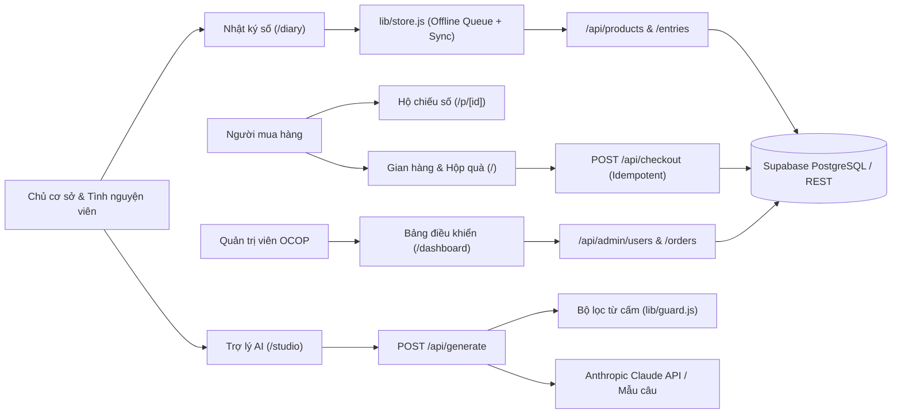
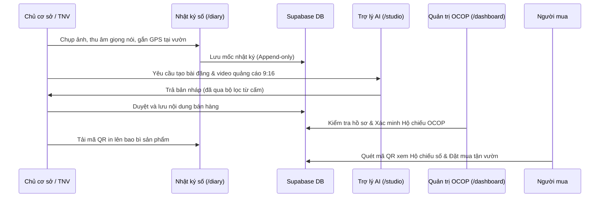

# OCOP Passport

**Hộ chiếu số giúp nông sản Đồng Nai minh bạch nguồn gốc, kể chuyện sản phẩm và bán được trên sàn thương mại điện tử.**

Dự án dự thi **“Hành trình Vườn ươm ý tưởng số” Tỉnh Đồng Nai 2026**, Bảng Sinh viên, chủ đề *Đô thị thông minh, kinh tế số Đồng Nai*.

- **Nhóm tác giả:** Hoàng Phương Thảo, Trịnh Trần Thảo Nguyên, Bùi Kim Ngân
- **Trường:** Đại học Công nghệ Đồng Nai (DNTU)

---

## Mục lục
1. [Giới thiệu](#1-giới-thiệu)
2. [Tính năng chính](#2-tính-năng-chính)
3. [Công nghệ sử dụng](#3-công-nghệ-sử-dụng)
4. [Bắt đầu nhanh](#4-bắt-đầu-nhanh)
5. [Cấu hình biến môi trường (.env.local)](#5-cấu-hình-biến-môi-trường-envlocal)
6. [Tài khoản Demo & 20 Khách hàng mẫu](#6-tài-khoản-demo--20-khách-hàng-mẫu)
7. [Phân quyền & Bảo mật hệ thống](#7-phân-quyền--bảo-mật-hệ-thống)
8. [Sơ đồ kiến trúc hệ thống](#8-sơ-đồ-kiến-trúc-hệ-thống)
9. [Cấu trúc thư mục](#9-cấu-trúc-thư-mục)
10. [Hướng dẫn dùng thử (Kịch bản Demo)](#10-hướng-dẫn-dùng-thử-kịch-bản-demo)
11. [Triển khai lên Vercel & Supabase](#11-triển-khai-lên-vercel--supabase)
12. [Làm việc nhóm & Xử lý sự cố](#12-làm-việc-nhóm--xử-lý-sự-cố)

---

## 1. Giới thiệu

Hợp tác xã, cơ sở sản xuất OCOP và nông hộ nhỏ ở Đồng Nai đang vướng ba điểm nghẽn khi bán hàng trực tuyến: người mua thiếu niềm tin vào nguồn gốc, chủ cơ sở khó tự làm nội dung bán hàng đa kênh, và dữ liệu sản xuất rời rạc. **OCOP Passport** giải quyết cả ba trong một quy trình khép kín, chạy ngay trên trình duyệt điện thoại mà không cần cài đặt ứng dụng:

1. **Ghi nhật ký sản xuất** bằng ảnh thực địa (tự động nén) và giọng nói tiếng Việt kèm tọa độ GPS.
2. **Tạo hộ chiếu số động** gắn mã QR in trên bao bì để người mua quét xem trọn hành trình từ vườn đến bàn ăn.
3. **Soạn nội dung bán hàng & dựng video bằng AI** từ chính dữ liệu thật trong nhật ký, có bộ lọc kiểm duyệt chống thổi phồng công dụng.
4. **Đặt mua trực tiếp tận vườn** (kèm tính năng tự đóng Hộp quà OCOP tổ ong 7 món) với cơ chế bảo vệ chống tạo đơn trùng lặp (`Idempotency-Key`).

Điểm khác biệt cốt lõi: Không dừng lại ở “truy xuất nguồn gốc”, mà **biến dữ liệu truy xuất thành lợi thế thương mại điện tử**.

---

## 2. Tính năng chính

| Phân hệ | Đường dẫn | Chức năng chi tiết |
|---|---|---|
| **Gian hàng & Giới thiệu** | `/` | Cảnh 3D quả ca cao, thẻ hộ chiếu lật 2 mặt (Flip Card), gian hàng đặc sản Đồng Nai, đóng **Hộp quà OCOP tự chọn (7 ô lục giác)**, giỏ hàng tính phí ship tự động, chuyển đổi song ngữ Việt - Anh. |
| **Nhật ký số sản xuất** | `/diary` | Chọn 6 công đoạn (*Gieo trồng, Chăm sóc, Thu hoạch, Sơ chế, Đóng gói, Xuất bán*); chụp ảnh (tự nén ≤ 800px); thu âm giọng nói nông hộ & nhận diện văn bản tiếng Việt; tự gắn giờ và tọa độ GPS; chế độ tình nguyện viên nhập hộ; **bản ghi chỉ thêm, không sửa (Immutable)**; lưu hàng đợi ngoại tuyến khi mất mạng. |
| **Hộ chiếu số công khai** | `/p/[id]` | Dòng thời gian sản xuất có ảnh & file ghi âm giọng nói nông dân, biểu đồ 6 chiều hương vị (`FlavorRadar`), bản đồ vùng trồng (OpenStreetMap), chứng nhận OCOP, câu chuyện nhà vườn, tải mã QR độ nét cao để in tem. |
| **Trợ lý bán hàng AI** | `/studio` | Tự động soạn mô tả sàn TMĐT, bài đăng Facebook/Zalo/TikTok, kịch bản livestream 10 phút, bản dịch tiếng Anh, hashtag; tích hợp trình dựng **Video quảng cáo dọc 9:16 (.webm)** có chèn sẵn mã QR và giá bán. |
| **Đăng nhập & Tài khoản** | `/login` | Đăng nhập, đăng ký tài khoản (Chủ cơ sở, Tình nguyện viên, Khách hàng), đổi mật khẩu, tích hợp nút chọn nhanh tài khoản Demo 1 chạm. |
| **Bảng điều khiển Admin** | `/dashboard` | Thống kê số HTX, sản phẩm, mốc nhật ký, tỷ lệ xác minh; thanh tiến độ hoàn thiện hồ sơ số; phát hiện cơ sở cần hỗ trợ; duyệt/bỏ xác minh hộ chiếu; chỉnh sửa giá nhanh; xuất bản sao lưu JSON. |
| **Quản lý người dùng** | `/dashboard/users` | Quản lý danh sách tài khoản & 20+ khách hàng; lọc theo vai trò; duyệt tình nguyện viên chờ duyệt; đổi vai trò; khóa tài khoản; gán chủ sở hữu cho từng sản phẩm OCOP. |

---

## 3. Công nghệ sử dụng

- **Frontend:** Next.js 15 (App Router), React 19, Three.js 0.128.0 (đồ họa 3D), `qrcode` (tạo mã QR động).
- **Backend & Database:** Next.js Route Handlers (`/api/*`), **Supabase (PostgreSQL Pool + REST API Fallback)**, giao dịch ACID & Row-Level Locking.
- **Xác thực & Bảo mật:** Phiên đăng nhập Cookie `httpOnly` ký HMAC-SHA256, băm mật khẩu chuẩn `scrypt` (`node:crypto`), chống CSRF (kiểm tra `Origin`/`Host`), Rate Limiting chống brute-force.
- **Trí tuệ nhân tạo & Đa phương tiện:** Anthropic Claude API (`claude-sonnet-5-5` kèm mẫu câu dự phòng), Web Speech API (nhận dạng giọng nói tiếng Việt), MediaRecorder API (ghi âm & kết xuất video `.webm` trên Canvas), Geolocation API.
- **PWA & Offline-First:** Service Worker (`public/sw.js`), Web App Manifest, hàng đợi đồng bộ `localStorage` (`ocop-outbox-v1`) tự động đẩy dữ liệu lên Supabase khi có mạng trở lại.

---

## 4. Bắt đầu nhanh

**Yêu cầu hệ thống:** Node.js 18.18 trở lên (khuyến nghị Node.js 20 LTS), npm.

```bash
# 1. Clone dự án từ GitHub
git clone [https://github.com/thao1123lls-code/ocop-passport.git](https://github.com/thao1123lls-code/ocop-passport.git)
cd ocop-passport

# 2. Cài đặt thư viện
npm install

# 3. Tạo file biến môi trường
cp .env.example .env.local     # Trên Windows CMD: copy .env.example .env.local

# 4. (Tùy chọn) Khởi tạo bảng & nạp dữ liệu mẫu lên PostgreSQL / Supabase
npm run db:seed

# 5. Chạy máy chủ phát triển
npm run dev
```

Mở trình duyệt tại: **http://localhost:3000**

| Lệnh | Tác dụng |
|---|---|
| `npm run dev` | Chạy chế độ phát triển (Hot Reload) tại `http://localhost:3000` |
| `npm run build` | Đóng gói bản tối ưu cho môi trường Production |
| `npm start` | Chạy bản Production (kích hoạt đầy đủ PWA Service Worker) |
| `npm run db:seed` | Tạo bảng (`schema.sql`) và nạp 10 sản phẩm + 24 tài khoản + 8 đơn hàng mẫu |
| `npm run db:gen-sql` | Sinh file `db/seed.sql` để dán trực tiếp vào Supabase SQL Editor |
| `npm run db:create-admin` | Tạo nhanh hoặc đặt lại mật khẩu tài khoản Quản trị viên |
| `npm run test:checkout` | Chạy bộ kiểm thử tự động logic đặt hàng & chống trừ tiền trùng (Idempotency) |

---

## 5. Cấu hình biến môi trường (`.env.local`)

Tạo file `.env.local` ở thư mục gốc của dự án (file này đã nằm trong `.gitignore`, tuyệt đối không commit lên Git):

```env
# 1. Kết nối Supabase (REST API & PostgreSQL)
NEXT_PUBLIC_SUPABASE_URL=[https://ymymfizxwtgsujiopmnh.supabase.co](https://ymymfizxwtgsujiopmnh.supabase.co)
NEXT_PUBLIC_SUPABASE_ANON_KEY=eyJhbGciOiJIUzI1NiIsInR5cCI6IkpXVCJ9...

# Chuỗi kết nối PostgreSQL trực tiếp (Tùy chọn - nếu để trống hệ thống tự động dùng Supabase REST API + Bộ nhớ dự phòng)
DATABASE_URL=postgresql://postgres.ymymfizxwtgsujiopmnh:[YOUR-DB-PASSWORD]@[aws-0-ap-southeast-1.pooler.supabase.com:6543/postgres](https://aws-0-ap-southeast-1.pooler.supabase.com:6543/postgres)
DATABASE_SSL=true

# 2. Bảo mật phiên đăng nhập (Tối thiểu 16 ký tự)
SESSION_SECRET=ocop-passport-supabase-secret-key-2026-dongnai
CHECKOUT_REQUIRE_LOGIN=false

# 3. Trợ lý AI Anthropic (Tùy chọn - bỏ trống hệ thống tự dùng mẫu câu chuẩn)
ANTHROPIC_API_KEY=
ANTHROPIC_MODEL=claude-sonnet-5-5
```

---

## 6. Tài khoản Demo & 20 Khách hàng mẫu

Hệ thống đã tích hợp sẵn **4 tài khoản Demo theo từng vai trò** và **20 tài khoản Khách hàng mẫu** (hoạt động ngay cả khi chạy chế độ dự phòng hoặc trên Supabase):

### 6.1. 4 Tài khoản Demo chính (Mật khẩu chung: `Demo@12345`)

| Vai trò | Email đăng nhập | Mật khẩu | Đường dẫn sử dụng | Quyền hạn |
|---|---|---|---|---|
| **Quản trị viên (`admin`)** | `admin@ocop.vn` | `Demo@12345` | `/dashboard` & `/dashboard/users` | Toàn quyền xác minh OCOP, sửa giá, duyệt/khóa tài khoản, gán chủ sở hữu. |
| **Chủ cơ sở (`owner`)** | `owner@ocop.vn` | `Demo@12345` | `/login` → `/diary`, `/studio` | Tạo sản phẩm mới, ghi nhật ký, sửa sản phẩm của mình, duyệt bài AI. |
| **Tình nguyện viên (`volunteer`)** | `volunteer@ocop.vn` | `Demo@12345` | `/login` → `/diary` | Ghi nhật ký sản xuất hộ nông dân cho mọi sản phẩm (gắn nhãn Đoàn viên). |
| **Khách hàng Demo** | `demo@ocop.vn` | `Demo@12345` | `/login` hoặc `/dashboard` | Trải nghiệm đặt hàng, đóng hộp quà, tra cứu QR và xem bảng điều khiển. |

### 6.2. 20 Tài khoản Khách hàng mẫu (Mật khẩu chung: `Khachhang@123`)
- **Danh sách Email:** Từ `nguyenvanan01@gmail.com` đến `baongoc.phan20@gmail.com` (xem chi tiết toàn bộ họ tên, số điện thoại, địa chỉ tại trang `/dashboard/users` hoặc trong `lib/db.js`).
- **Mật khẩu chung:** `Khachhang@123`

---

## 7. Phân quyền & Bảo mật hệ thống

### 7.1. Ma trận phân quyền theo vai trò

| Thao tác trên hệ thống | Khách | `volunteer` | `owner` | `admin` |
|---|:---:|:---:|:---:|:---:|
| Xem gian hàng, hộ chiếu số, quét QR, đặt mua COD | ✓ | ✓ | ✓ | ✓ |
| Thêm mốc nhật ký sản xuất (kèm ảnh, ghi âm, GPS) | | ✓ *(mọi SP)* | ✓ *(SP của mình)* | ✓ |
| Tạo sản phẩm OCOP mới | | | ✓ | ✓ |
| Sửa thông tin, xóa sản phẩm, soạn & duyệt nội dung AI | | | ✓ *(SP của mình)* | ✓ |
| Xác minh / Bỏ xác minh chuẩn OCOP trên hộ chiếu | | | | ✓ |
| Quản lý người dùng, duyệt tình nguyện viên, gán chủ sở hữu | | | | ✓ |

### 7.2. Nguyên tắc bảo vệ dữ liệu, đơn hàng & nội dung AI
- **Nhật ký bất biến (Append-Only):** Bảng `diary_entries` có Trigger PostgreSQL (`forbid_entry_update`) chặn mọi lệnh `UPDATE` sửa đổi nội dung nhật ký cũ, đảm bảo tính minh bạch tuyệt đối khi truy xuất.
- **Tính tiền phía Máy chủ & Chống tạo đơn trùng (`Idempotency-Key`):**
  - `POST /api/checkout` bỏ qua mọi mức giá do trình duyệt gửi lên và tự truy vấn lại bảng `products` để tính tổng tiền chính xác.
  - Bắt buộc đính kèm `Idempotency-Key` (UUID v4). Nếu mạng chập chờn khiến người mua bấm gửi lặp lại cùng một giỏ hàng, hệ thống trả về lại đúng mã đơn cũ (`isDuplicatePrevented: true`) mà không tạo đơn thứ 2.
- **Kiểm soát nội dung AI (`lib/guard.js`):**
  - AI chỉ được phép viết dựa trên dữ kiện thật có trong nhật ký sản xuất.
  - Tự động quét và cảnh báo các cụm từ thổi phồng hoặc tuyên bố y tế trái phép (ví dụ: *“chữa khỏi”, “thần dược”, “tốt nhất”, “số 1”, “100% an toàn”*) và **khóa nút Duyệt** cho đến khi chủ cơ sở chỉnh sửa hợp lệ.

---

## 8. Sơ đồ kiến trúc hệ thống

### 8.1. Kiến trúc tổng thể Full-Stack (Next.js + Supabase + AI)



### 8.2. Luồng hoạt động từ vườn trồng đến tay người tiêu dùng



---

## 9. Cấu trúc thư mục

```text
ocop-passport-main/
├── app/
│   ├── layout.jsx                     # Khung giao diện chung, SEO, NavBar, Widgets
│   ├── globals.css                    # Hệ thống thiết kế Dark Cyber Slate
│   ├── page.jsx                       # Trang chủ (Hero 3D, Gian hàng, Hộp quà, Công cụ)
│   ├── login/page.jsx                 # Trang đăng nhập, đăng ký & chọn nhanh Demo
│   ├── diary/page.jsx                 # Nhật ký sản xuất số (Ảnh, Giọng nói, GPS)
│   ├── p/[id]/page.jsx                # Trang Hộ chiếu số công khai & Bản đồ hương vị
│   ├── studio/page.jsx                # Trợ lý bán hàng AI & Tạo video quảng cáo 9:16
│   ├── dashboard/
│   │   ├── page.jsx                   # Bảng điều khiển quản trị & Xác minh OCOP
│   │   └── users/page.jsx             # Quản lý người dùng, 20 khách hàng & Gán chủ SP
│   └── api/
│       ├── auth/{login,register,logout,me,password}/route.js
│       ├── products/route.js          # GET/POST danh sách sản phẩm
│       ├── products/[id]/route.js     # GET/PATCH/DELETE sản phẩm
│       ├── products/[id]/entries/route.js # POST thêm mốc nhật ký
│       ├── checkout/route.js          # POST đặt hàng chống trùng lặp (Idempotent)
│       ├── generate/route.js          # POST soạn nội dung AI
│       └── admin/{users,orders}/route.js
├── components/
│   ├── Hero.jsx & Hero3D.jsx          # Banner 3D & Thẻ hộ chiếu lật 2 mặt
│   ├── StorefrontHome.jsx             # Gian hàng, bộ lọc, Modal chi tiết & QR
│   ├── GiftBoxBuilder.jsx             # Đóng hộp quà OCOP lục giác 7 món
│   ├── CartDrawer.jsx                 # Giỏ hàng trượt & Thanh tiến trình Freeship
│   ├── VoiceReactiveDotLoader.jsx     # Bộ thu âm giọng nói phản hồi sóng âm
│   ├── VideoCreator.jsx               # Dựng video quảng cáo 9:16 (.webm)
│   ├── FlavorRadar.jsx                # Biểu đồ 6 chiều hương vị sản phẩm
│   └── JourneyShowcase.jsx            # Trình chiếu 6 chặng hành trình sản xuất
├── db/
│   ├── schema.sql                     # Cấu trúc bảng PostgreSQL / Supabase
│   ├── seed-data.mjs                  # Dữ liệu mẫu (10 sản phẩm, 24 user, 8 đơn hàng)
│   └── seed.sql                       # File SQL tổng hợp để chạy trên Supabase
├── lib/
│   ├── db.js                          # Kết nối Dual-Mode (PG Pool + Supabase REST + Fallback)
│   ├── auth.js & auth-client.js       # Quản lý phiên đăng nhập HMAC & Hook useAuth()
│   ├── password.mjs                   # Mã hóa và kiểm tra mật khẩu scrypt
│   ├── checkout.mjs & idempotency.mjs # Nghiệp vụ tính tiền server & chống trùng đơn
│   ├── store.js                       # Đồng bộ dữ liệu & hàng đợi ngoại tuyến
│   ├── guard.js                       # Bộ lọc từ ngữ quảng cáo vi phạm
│   └── i18n.js                        # Từ điển song ngữ Việt - Anh
├── scripts/
│   ├── seed.mjs                       # Script nạp dữ liệu tự động vào DB
│   ├── create-admin.mjs               # Script tạo tài khoản Admin từ CLI
│   └── test-checkout.mjs              # Kiểm thử tự động hệ thống thanh toán
├── high-concurrency-form/             # Phân hệ mở rộng: Web Form chịu tải cao (BullMQ + Redis)
├── public/                            # Hình ảnh sản phẩm, icon, manifest, service worker
├── .env.example
└── package.json
```

---

## 10. Hướng dẫn dùng thử (Kịch bản Demo)

1. **Đăng nhập Quản trị viên:** Mở `/dashboard`, nhập `admin@ocop.vn` / `Demo@12345` để xem thống kê toàn tỉnh, bấm **“Quản lý người dùng”** (`/dashboard/users`) để kiểm tra danh sách 24 tài khoản (4 Demo + 20 Khách hàng).
2. **Ghi nhật ký bằng giọng nói & ảnh:** Mở `/diary`, chọn sản phẩm *“Bột Ca cao nguyên chất Trọng Đức”*, chọn công đoạn *“Thu hoạch”*, bấm nút Micro nói vài câu tiếng Việt, tải ảnh lên và bấm **“Lưu vào nhật ký”**.
3. **Quét QR & Xem Hộ chiếu số:** Bấm **“Mở hộ chiếu số”** (`/p/bot-ca-cao-nguyen-chat-trong-duc`), nghe lại đoạn ghi âm vừa nói, xem biểu đồ hương vị 6 chiều, chuyển thử sang Tiếng Anh (`EN`) ở góc trên phải và tải mã QR về máy.
4. **Tạo nội dung & Video quảng cáo AI:** Mở `/studio`, bấm **“Soạn nội dung từ nhật ký”**, kiểm tra bộ lọc từ cấm và bấm **“Duyệt nội dung”**. Cuộn xuống mục **AI Dựng Video (9:16)**, bấm **“Tạo video quảng cáo ngay (.webm)”** để xem và tải video.
5. **Đóng hộp quà & Đặt hàng chống trùng:** Về trang chủ `/`, cuộn xuống mục **“Tự tay đóng hộp quà”**, chọn 7 món đặc sản vào tổ ong, viết lời chúc và thêm vào giỏ. Mở giỏ hàng và đặt mua để nhận mã đơn hàng bảo vệ bởi `Idempotency-Key`.

---

## 11. Triển khai lên Vercel & Supabase

1. **Trên Supabase (`https://supabase.com`):**
   - Mở **SQL Editor**, dán nội dung file `db/schema.sql` và `db/seed.sql` vào rồi bấm **Run**.
   - Lấy `Project URL`, `anon public key` (trong *Project Settings → API*) và `Connection string URI` (trong *Project Settings → Database*).
2. **Trên Vercel (`https://vercel.com`):**
   - Đăng nhập bằng GitHub, chọn **Add New → Project** và import repository `ocop-passport`.
   - Tại mục **Environment Variables**, thêm các biến: `NEXT_PUBLIC_SUPABASE_URL`, `NEXT_PUBLIC_SUPABASE_ANON_KEY`, `DATABASE_URL`, `DATABASE_SSL=true`, `SESSION_SECRET`, và `ANTHROPIC_API_KEY` (nếu có).
   - Bấm **Deploy**. Vercel sẽ cấp tên miền có sẵn HTTPS giúp Micro và định vị GPS hoạt động hoàn hảo trên mọi thiết bị di động.

---

## 12. Làm việc nhóm & Xử lý sự cố

### Quy trình Git cho nhóm
```bash
git pull origin main                   # Lấy code mới nhất về máy
git checkout -b feat/ten-tinh-nang     # Tạo nhánh riêng khi phát triển tính năng mới
git add .
git commit -m "feat: mo ta thay doi"
git push -u origin feat/ten-tinh-nang
```

### Bảng xử lý sự cố nhanh

| Vấn đề gặp phải | Cách khắc phục |
|---|---|
| Báo lỗi khi đăng nhập trên máy mới | Đảm bảo đã cập nhật `lib/db.js`, `lib/auth.js` và `app/api/auth/login/route.js` bản mới nhất (tích hợp sẵn 24 tài khoản dự phòng). Ở trang `/dashboard` nhớ dùng `admin@ocop.vn` / `Demo@12345`. |
| Cổng 3000 đang bị ứng dụng khác chiếm | Dừng ứng dụng đang dùng cổng 3000 rồi chạy lại `npm run dev`. |
| Micro hoặc GPS không hoạt động | Chỉ hoạt động trên `http://localhost` hoặc tên miền có `https://`. Hãy cấp quyền Micro/Vị trí cho trình duyệt (khuyến nghị dùng Chrome hoặc Edge). |
| Git báo lỗi `Filename too long` trên Windows | Mở PowerShell chạy `git config --global core.longpaths true`. |
| Trợ lý AI báo “Soạn bằng mẫu câu” | Bạn chưa điền `ANTHROPIC_API_KEY` trong `.env.local` — hệ thống tự động chuyển sang bộ mẫu câu thông minh để không làm gián đoạn trải nghiệm. |

---

## Bản quyền

© 2026 Nhóm tác giả **Hoàng Phương Thảo, Trịnh Trần Thảo Nguyên, Bùi Kim Ngân** — Trường Đại học Công nghệ Đồng Nai (DNTU). Vui lòng liên hệ nhóm tác giả trước khi sử dụng lại mã nguồn cho mục đích thương mại.
