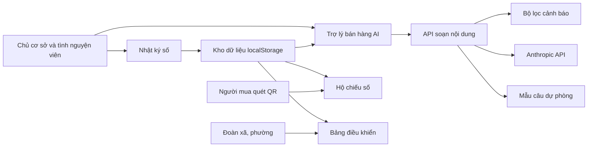
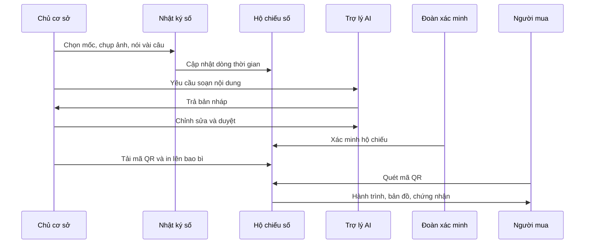
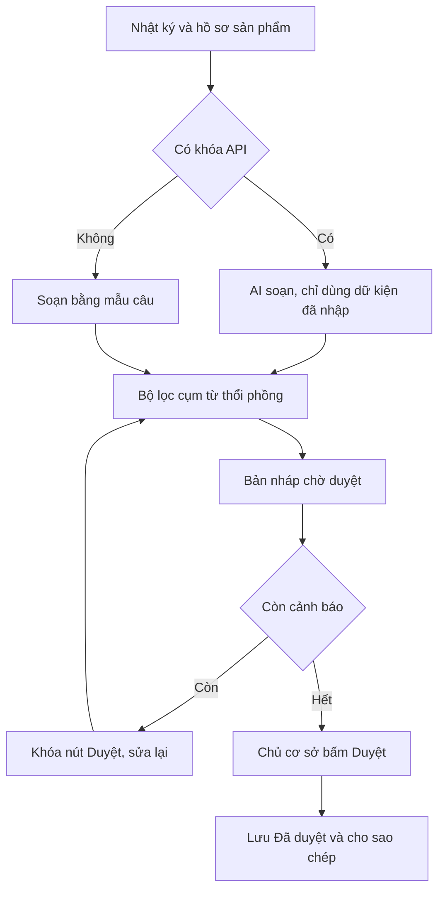
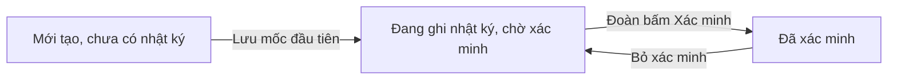
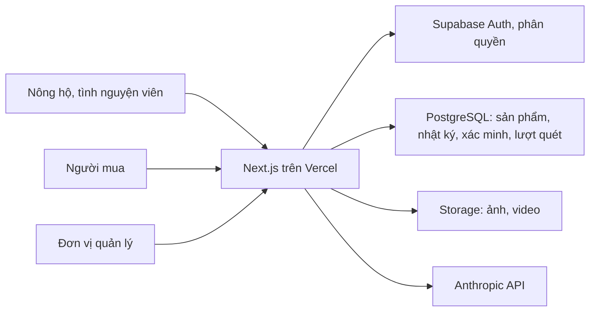

# OCOP Passport

**Hộ chiếu số giúp nông sản Đồng Nai minh bạch nguồn gốc, kể chuyện sản phẩm và bán được trên sàn thương mại điện tử.**

Dự án dự thi **“Hành trình Vườn ươm ý tưởng số” TP. Đồng Nai 2026**, Bảng Sinh viên, chủ đề *Đô thị thông minh, kinh tế số Đồng Nai*.

- **Nhóm tác giả:** Hoàng Phương Thảo, Trịnh Trần Thảo Nguyên, Bùi Kim Ngân
- **Trường:** Đại học Công nghệ Đồng Nai

---

## Mục lục
1. [Giới thiệu](#giới-thiệu)
2. [Tính năng](#tính-năng)
3. [Công nghệ](#công-nghệ)
4. [Bắt đầu nhanh](#bắt-đầu-nhanh)
5. [Biến môi trường](#biến-môi-trường)
6. [Hướng dẫn dùng thử](#hướng-dẫn-dùng-thử)
7. [Cấu trúc thư mục](#cấu-trúc-thư-mục)
8. [Cách hệ thống hoạt động](#cách-hệ-thống-hoạt-động)
9. [Sơ đồ hệ thống](#sơ-đồ-hệ-thống)
10. [Triển khai lên Vercel](#triển-khai-lên-vercel)
11. [Giới hạn hiện tại](#giới-hạn-hiện-tại)
12. [Lộ trình phát triển](#lộ-trình-phát-triển)
13. [Làm việc nhóm](#làm-việc-nhóm)
14. [Xử lý sự cố](#xử-lý-sự-cố)

---

## Giới thiệu

Hợp tác xã, cơ sở sản xuất OCOP và nông hộ nhỏ ở Đồng Nai đang vướng ba điểm nghẽn khi bán online: người mua thiếu niềm tin vào nguồn gốc, chủ cơ sở khó tự làm nội dung bán hàng, và dữ liệu sản xuất rời rạc. OCOP Passport giải quyết cả ba trong một quy trình, chạy ngay trên trình duyệt điện thoại, không cần cài đặt:

1. **Ghi nhật ký sản xuất** bằng ảnh và giọng nói.
2. **Tạo hộ chiếu số** gắn mã QR in trên bao bì để người mua quét xem hành trình sản phẩm.
3. **Soạn nội dung bán hàng bằng AI** từ chính dữ liệu thật trong nhật ký.

Điểm khác biệt: không dừng ở “truy xuất”, mà **biến dữ liệu truy xuất thành lợi thế bán hàng**.

## Tính năng

| Phân hệ | Đường dẫn | Chức năng |
|---|---|---|
| Giới thiệu | `/` | Trang chủ có quả ca cao 3D, thẻ hộ chiếu mẫu nghiêng theo chuột, hiệu ứng cuộn |
| Nhật ký số | `/diary` | Chọn 6 mốc (Gieo trồng, Chăm sóc, Thu hoạch, Sơ chế, Đóng gói, Xuất bán); chụp/chọn ảnh (tự nén); nhập giọng nói tiếng Việt; tự gắn thời gian và vị trí GPS; chế độ tình nguyện viên nhập hộ; bản ghi chỉ thêm, không sửa; dùng được khi mất mạng; quản lý hồ sơ sản phẩm |
| Hộ chiếu số | `/p/[id]` | Trang công khai: dòng thời gian có ảnh, bản đồ vùng trồng (OpenStreetMap), chứng nhận, câu chuyện, thông tin sản phẩm, nút mua hàng, chia sẻ, song ngữ Việt - Anh, mã QR tải về |
| Trợ lý bán hàng AI | `/studio` | Soạn mô tả sàn TMĐT, bài đăng mạng xã hội, kịch bản livestream 10 phút, bản tiếng Anh, hashtag và gợi ý giờ đăng; luôn là bản nháp chờ duyệt |
| Bảng điều khiển | `/dashboard` | Số cơ sở, sản phẩm, mốc nhật ký; thanh tiến độ hoàn thiện; danh sách cơ sở cần hỗ trợ; xác minh hộ chiếu; xuất dữ liệu JSON |

### Nguyên tắc kiểm soát nội dung AI
- AI **chỉ viết dựa trên dữ liệu đã nhập**, không tự thêm công dụng, chứng nhận hay số liệu.
- Mọi nội dung là **bản nháp**; chủ cơ sở xem và bấm **Duyệt** mới lưu.
- Bộ lọc (`lib/guard.js`) cảnh báo cụm từ thổi phồng hoặc tuyên bố y tế (ví dụ “chữa bệnh”, “tốt nhất”, “100% an toàn”) và **khóa nút Duyệt** cho đến khi sửa.

## Công nghệ

- **Next.js 15** (App Router) và **React 19**
- **three.js 0.128.0** cho hiệu ứng 3D (nạp lười, chỉ ở trang chủ)
- **qrcode** để tạo mã QR (nạp lười, chỉ ở trang hộ chiếu)
- **Anthropic API** (tùy chọn) cho trợ lý AI, gọi qua route phía máy chủ
- **Web Speech API** nhận dạng giọng nói, **Geolocation API** lấy vị trí
- **PWA**: manifest và service worker để dùng ngoại tuyến
- Lưu trữ hiện tại: `localStorage` của trình duyệt

## Bắt đầu nhanh

**Yêu cầu:** Node.js 18.18 trở lên (khuyến nghị bản LTS 20+), npm.

```bash
git clone https://github.com/thao1123lls-code/ocop-passport.git
cd ocop-passport
npm install
cp .env.example .env.local     # Windows CMD: copy .env.example .env.local
npm run dev
```

Mở http://localhost:3000.

| Lệnh | Tác dụng |
|---|---|
| `npm run dev` | Chạy chế độ phát triển, tự tải lại khi sửa code |
| `npm run build` | Build bản tối ưu (cần Internet để tải font lần đầu) |
| `npm start` | Chạy bản đã build; chỉ ở chế độ này service worker mới bật |

## Biến môi trường

Tạo file `.env.local` (đã được `.gitignore` loại trừ, **không bao giờ commit file này**):

| Biến | Bắt buộc | Mô tả |
|---|---|---|
| `ANTHROPIC_API_KEY` | Không | Khóa API để dùng AI thật. Bỏ trống thì trợ lý dùng mẫu câu có sẵn |
| `ANTHROPIC_MODEL` | Không | Tên mô hình, mặc định `claude-sonnet-5-5` |

## Hướng dẫn dùng thử

1. Vào **Nhật ký số**, chọn mốc “Thu hoạch”, gõ hoặc bấm **Nói bằng giọng nói**, thêm ảnh, bấm **Lưu**.
2. Mở **Hồ sơ sản phẩm** để điền khối lượng, thành phần, chứng nhận, câu chuyện, link gian hàng.
3. Bấm **Xem hộ chiếu số và mã QR**: chuyển song ngữ, tải mã QR về in tem.
4. Vào **Trợ lý bán hàng**, bấm **Soạn nội dung từ nhật ký**, chỉnh sửa rồi **Duyệt**.
5. Vào **Bảng điều khiển**, bấm **Xác minh hộ chiếu** để bỏ cảnh báo “chờ xác minh”.

> Micro và GPS chỉ hoạt động trên `localhost` hoặc HTTPS. Nhận dạng giọng nói cần Chrome hoặc Edge.

## Cấu trúc thư mục

```
ocop-passport/
├── app/
│   ├── layout.jsx            # Khung chung, font, metadata SEO, thanh điều hướng
│   ├── globals.css           # Giao diện (tự đổi sáng/tối)
│   ├── page.jsx              # Trang chủ
│   ├── diary/page.jsx        # Nhật ký số
│   ├── p/[id]/page.jsx       # Hộ chiếu số công khai
│   ├── studio/page.jsx       # Trợ lý bán hàng AI
│   ├── dashboard/page.jsx    # Bảng điều khiển
│   └── api/generate/route.js # API soạn nội dung (gọi Anthropic hoặc dùng mẫu câu)
├── components/
│   ├── Hero.jsx              # Phần đầu trang chủ và thẻ hộ chiếu nghiêng 3D
│   ├── Hero3D.jsx            # Cảnh three.js (quả ca cao, hạt bay)
│   └── PWA.jsx               # Đăng ký service worker, thanh tiến trình, hiệu ứng cuộn
├── lib/
│   ├── store.js              # Lưu trữ dữ liệu, hằng số mốc sản xuất, mã hóa link QR
│   └── guard.js              # Bộ lọc cụm từ quảng cáo vi phạm
├── public/                   # manifest, service worker, biểu tượng
├── .env.example
└── package.json
```

## Cách hệ thống hoạt động

- **Mã QR không cần máy chủ.** Link trong QR chứa bản rút gọn của hồ sơ (không kèm ảnh), mã hóa trong tham số `?d=`. Vì vậy quét trên bất kỳ máy nào cũng mở được hộ chiếu. Khi có cơ sở dữ liệu thật, link sẽ chỉ cần mã sản phẩm và tem in sẵn vẫn dùng được.
- **Bản ghi chỉ thêm, không sửa.** Mỗi mốc lưu kèm giờ, vị trí và người nhập (chủ cơ sở hay tình nguyện viên) để hạn chế chỉnh dữ liệu về sau.
- **Ngoại tuyến.** Service worker lưu đệm các trang đã mở; dữ liệu nhập khi mất mạng nằm sẵn trên máy.
- **Hiệu năng.** Ảnh nén còn tối đa 800 px; three.js và qrcode chỉ tải khi cần; cảnh 3D tạm dừng khi cuộn khỏi màn hình và tắt khi người dùng bật “giảm chuyển động”.
- **Bảo mật.** Khóa API chỉ nằm ở máy chủ (`/api/generate`), không lộ ra trình duyệt. Link mua hàng chỉ chấp nhận `http(s)://`.
- **Quyền riêng tư.** Hệ thống chưa thu thập thông tin cá nhân của người dùng; vị trí chỉ lấy khi bấm lưu và là tùy chọn.

## Sơ đồ hệ thống

> Các sơ đồ dưới đây dùng Mermaid, GitHub tự hiển thị khi xem README trên web.

### 1. Kiến trúc hiện tại



### 2. Luồng sử dụng từ vườn đến người mua



### 3. Kiểm soát nội dung AI



### 4. Vòng đời của một hộ chiếu số



### 5. Kiến trúc mục tiêu khi có máy chủ (lộ trình)



## Triển khai lên Vercel

1. Đẩy mã lên GitHub.
2. Vào vercel.com, đăng nhập bằng GitHub, chọn **Add New → Project** và chọn repo này.
3. Thêm biến `ANTHROPIC_API_KEY` ở mục **Environment Variables** (nếu muốn dùng AI thật).
4. Bấm **Deploy**. Từ đó mỗi lần `git push` trang tự cập nhật, và có HTTPS để dùng micro, GPS trên điện thoại.

## Giới hạn hiện tại

Đây là bản chạy được các chức năng cốt lõi, **chưa có máy chủ lưu trữ**:

- Dữ liệu nằm trong trình duyệt từng thiết bị, chưa đồng bộ giữa các máy.
- Chưa có đăng nhập và phân quyền (chủ cơ sở, tình nguyện viên, đơn vị quản lý).
- Bảng điều khiển chỉ thấy dữ liệu trên thiết bị đang dùng, chưa đếm được lượt quét mã.
- Ảnh chỉ hiện trên máy đã chụp; mã QR chỉ mang dữ liệu chữ. Dung lượng lưu ảnh bị giới hạn bởi trình duyệt.
- Chưa có nhận dạng giọng nói khi trình duyệt không hỗ trợ (vẫn nhập tay được).
- Bản tiếng Anh khi chưa có API key chỉ dịch tên các mốc, không dịch lời kể.
- Nút xác minh hiện ai cũng bấm được; cần phân quyền để chỉ đơn vị có thẩm quyền xác minh.

## Lộ trình phát triển

- [ ] Thay `lib/store.js` bằng **Supabase**: đăng nhập, phân quyền theo vai trò, bảng dữ liệu dùng chung
- [ ] Lưu ảnh trên máy chủ và hiển thị ảnh trên hộ chiếu với mọi người xem
- [ ] Đếm lượt quét mã, thống kê theo thời gian cho bảng điều khiển
- [ ] Lịch sử chỉnh sửa và băm dữ liệu để chống sửa số liệu
- [ ] Quy trình xác minh có chữ ký của Đoàn xã, phường hoặc đơn vị hỗ trợ OCOP
- [ ] Soạn nội dung theo chuẩn riêng từng sàn (Shopee, TikTok Shop, Zalo)
- [ ] Mã QR động trỏ về mã sản phẩm (không nhúng dữ liệu vào link)
- [ ] Biểu tượng ứng dụng PNG để cài lên màn hình chính điện thoại

## Làm việc nhóm

```bash
git pull                         # lấy code mới nhất
git checkout -b ten-tinh-nang    # mỗi người một nhánh riêng
git add . && git commit -m "Mo ta thay doi"
git push -u origin ten-tinh-nang # rồi tạo Pull Request trên GitHub
```

Không commit `.env.local`, `node_modules/`, `.next/`.

## Xử lý sự cố

| Vấn đề | Cách xử lý |
|---|---|
| `npm` không nhận diện | Cài Node.js, đóng hẳn rồi mở lại VS Code |
| Cổng 3000 đang bận | `npm run dev -- -p 3001` |
| Micro hoặc GPS không hoạt động | Dùng `localhost` hoặc HTTPS; cho phép quyền trong trình duyệt |
| Không thấy hiệu ứng 3D | Trình duyệt tắt WebGL hoặc bật “giảm chuyển động” (thiết kế có chủ đích) |
| Trợ lý AI báo “mẫu câu” | Chưa điền `ANTHROPIC_API_KEY` hoặc key không hợp lệ; trang vẫn chạy bằng mẫu câu |
| Mất dữ liệu demo | Dữ liệu lưu trong trình duyệt; xóa dữ liệu trang hoặc dùng cửa sổ ẩn danh sẽ về mặc định |
| `npm run build` lỗi tải font | Cần kết nối Internet lúc build |

## Giấy phép

Chưa chọn giấy phép. Vui lòng liên hệ nhóm tác giả trước khi sử dụng lại mã nguồn.